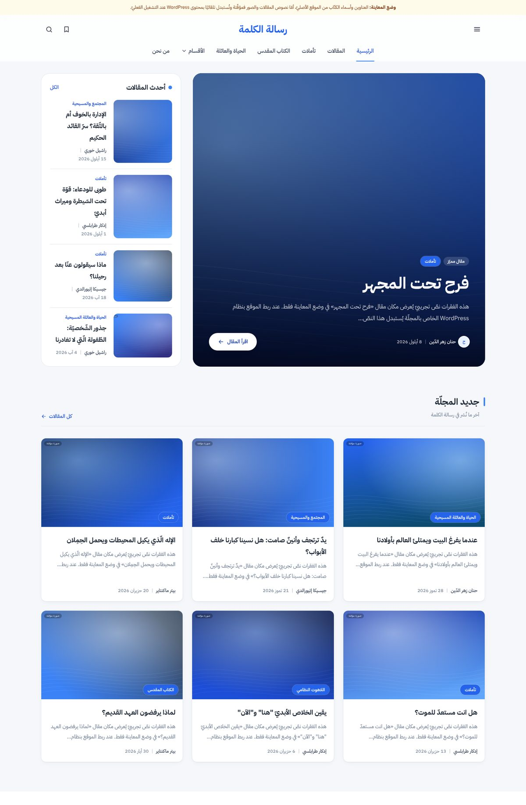
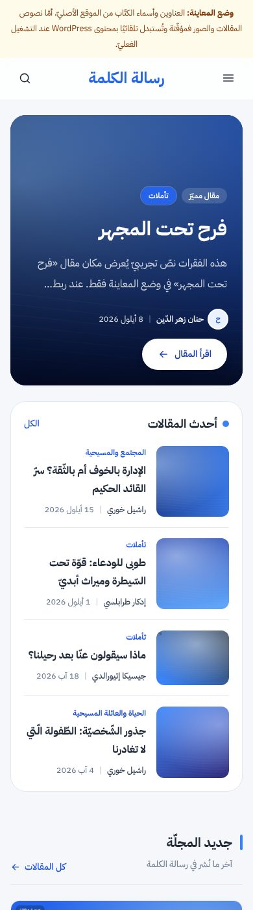
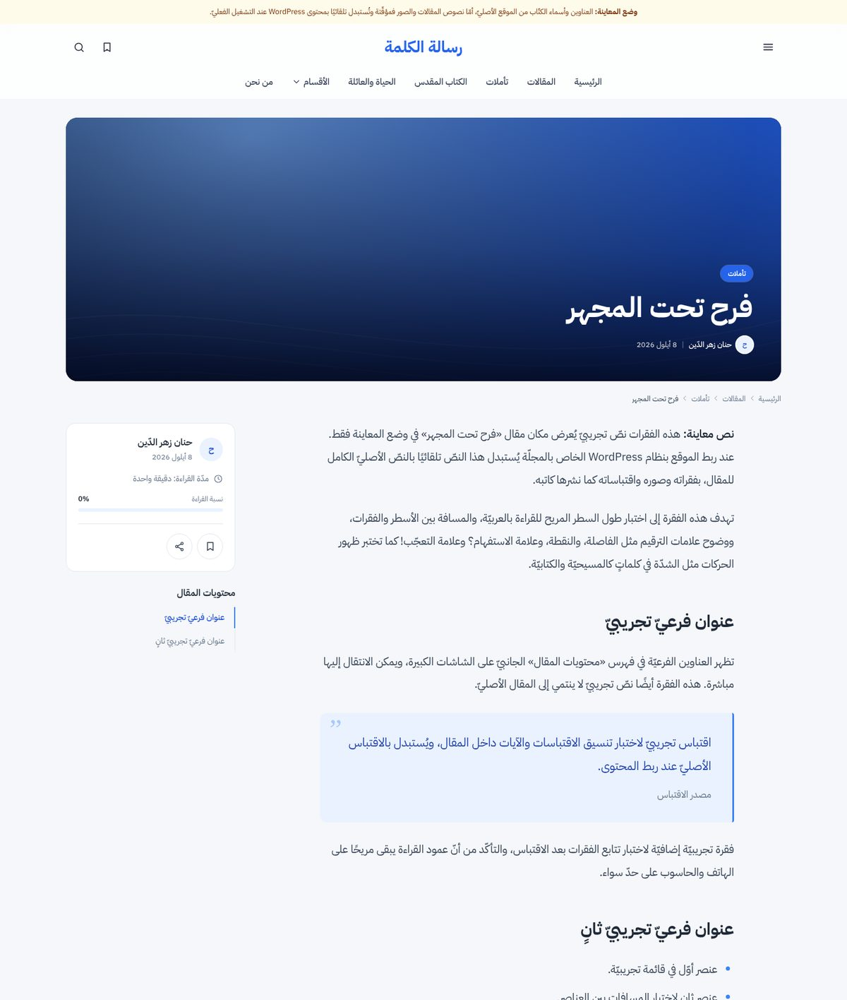
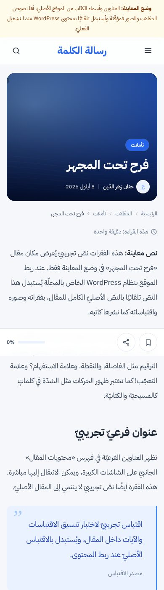
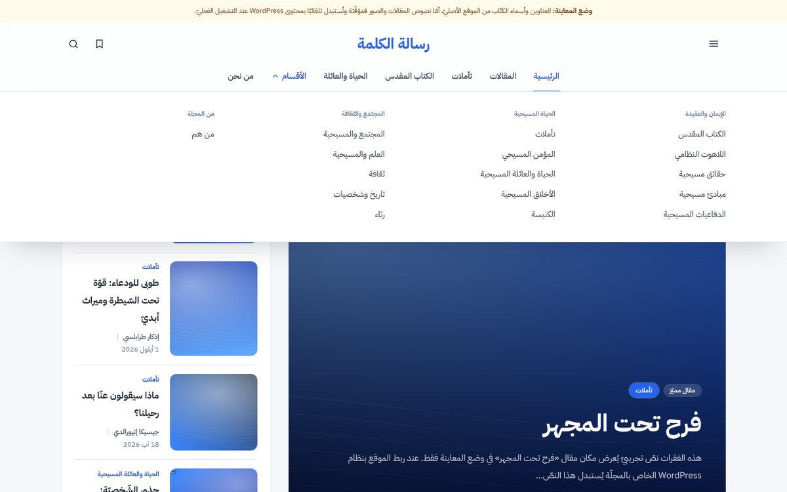
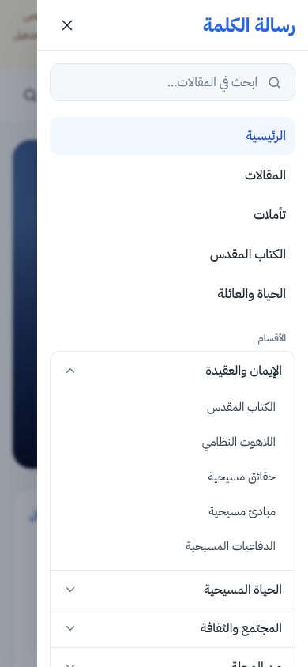

# رسالة الكلمة — Website redesign

A modern, Arabic-first (RTL) front end for **مجلة رسالة الكلمة** ([risalatalkalima.com](https://risalatalkalima.com)).
It runs **headless on top of the magazine's existing WordPress**: articles, authors, categories, tags,
images and the logo are all read live from the WordPress REST API, so editors keep publishing exactly as
they do today and no content is copied, rewritten or invented.

| Desktop | Mobile |
| --- | --- |
|  |  |
|  |  |
|  |  |

> Screenshots are from **preview mode**: titles and author names are real, but article text and
> images are labelled placeholders (see [Preview data](#preview-data)). In production the same
> templates show the real articles, photos and logo from WordPress.

---

## 1. Audit summary

| What | Finding |
| --- | --- |
| Platform | WordPress (Yoast-style titles such as «… Archives - مجلة رسالة الكلمة», `/author/risala210/`, `/tag/…/`, `/articles/`). Permalinks are `/%postname%/` with Arabic slugs. |
| Access from the build session | **Blocked.** `risalatalkalima.com` is denied by the build environment's network policy, so the HTML, the logo file and the REST API could not be downloaded here. Facts below come from the search-engine index of the site. |
| Mission (من نحن) | «رسالة الكلمة» مجلّة مسيحيّة فصليّة تتناول الموضوعات الروحيّة والأخلاقيّة والاجتماعيّة من وجهة نظر كتابيّة (بيبليّة)، وتهدف إلى تعزيز إيمان المؤمنين وتقريب البعيدين إلى الله. Licensed by the Lebanese Ministry of Information; editor-in-chief القسّيس د. ادكار طرابلسي with 40 volunteers; 70% local writers / 30% translation. *(The publisher's name appears as both «كنيسة لبنان الكتابيّة الإنجيليّة» and «كنيسة لبنان الإنجيليّة» on the site — please confirm.)* |
| Reference article | «فرح تحت المجهر» — حنان زهر الدّين — 8 أيلول 2026 — تأملات — tags تأملات، رسالة الكلمة، سعادة، عبرة الحياة، فرح — previous «طوبى للودعاء: قوّة تحت السّيطرة وميراث أبديّ», next «الإدارة بالخوف أم بالثّقة؟ سرّ القائد الحكيم». |
| Categories | The 27 menu categories listed in the brief (تأملات، الكتاب المقدس، … موسيقى) are configured in `src/lib/site.ts` and matched **by name** to live WordPress categories (diacritics and hamza variants ignored), so real slugs/URLs come from the CMS. |
| Not verifiable from here | Logo file, social-media URLs, contact details, newsletter provider, contact-form plugin. None of these were invented — see [What to confirm](#6-what-to-confirm-before-launch). |

## 2. Architecture

- **Next.js 16 (App Router) · React 19 · TypeScript · Tailwind CSS 4**, self-hosted **IBM Plex Sans Arabic**.
- `src/lib/content/` — one `ContentSource` interface with two implementations:
  - `wordpress.ts` — WordPress REST v2 (`/wp/v2/posts|pages|categories|tags|users|media`, `_embed`,
    `X-WP-Total` pagination, `before/after` for previous/next, `site_logo` for the logo). Responses are
    cached (ISR, `WP_REVALIDATE_SECONDS`, default 10 min) and can be refreshed instantly via `/api/revalidate`.
  - `fixtures.ts` — preview data for development and tests only (`CONTENT_SOURCE=fixtures`).
- **Arabic search** (`src/lib/search.ts`): normalises diacritics (incl. shadda), hamza forms, ى/ي, ة/ه,
  tatweel, Arabic-Indic digits and the definite article; ranks title › author › category/tag › excerpt.
  For WordPress it indexes titles, excerpts, authors, categories and tags, and merges WordPress's own
  full-text search for matches in article bodies.
- **URLs are preserved**: `/{slug}/`, `/category/{slug}/`, `/tag/{slug}/`, `/author/{slug}/`, `/articles/`,
  `/feed/` (RSS) — `trailingSlash` is on, exactly like WordPress. WordPress *pages* resolve on `/{slug}/` too.
- SEO: per-page metadata, canonical URLs, Open Graph, `Article` / `BreadcrumbList` / `Person` / `WebSite`
  (SearchAction) JSON-LD, `sitemap.xml`, `robots.txt`, `lang="ar" dir="rtl"`. Preview mode is `noindex`.

### Pages

| Route | Template |
| --- | --- |
| `/` | Editorial home: featured story (WordPress *sticky* post, else latest), latest list, «جديد المجلّة» grid, «مختارات المحرّر» (other sticky posts), category sections (تأملات، الكتاب المقدّس واللاهوت، الحياة والعائلة، مقابلات وشخصيّات), video section (only if «فيديو مسيحي» has posts), mission, newsletter. |
| `/{slug}/` | Article: hero, breadcrumbs, reading column, table of contents, reading progress (top bar + sidebar + mobile bar), share (native sheet / copy link / Facebook / X / WhatsApp / print), persistent bookmarks, tags, author box with more by the author, previous/next, related articles, print stylesheet. |
| `/articles/` | Archive with search, category filter, sort (newest / oldest / A–Z) and pagination — all URL-driven. |
| `/category/{slug}/` | Reusable category archive (video and books categories get media/library treatment). |
| `/tag/{slug}/`, `/author/{slug}/` | Tag and author archives. |
| `/search/?q=` | Results with category facets, empty state; header overlay with live results (press `/` to open). |
| `/about/`, `/contact/` | Use the WordPress pages (`ABOUT_PAGE_SLUG`, `CONTACT_PAGE_SLUG`) when present; About falls back to the magazine's own published statements. |
| `/saved/` | Saved articles (localStorage, synced across tabs). |

«الأكثر قراءة» is **not** shown: WordPress exposes no view counts. The curated «مختارات المحرّر» section
is labelled as such. Add a popularity plugin with a REST field and a `popular` sort can be wired in.

## 3. Running locally

```bash
npm install
cp .env.example .env.local      # then adjust

npm run dev:preview             # preview data, no network needed
npm run dev                     # live WordPress (needs access to WP_API_URL)

npm run lint && npm run typecheck && npm test
npx playwright test             # journeys A–I + accessibility, desktop & mobile (uses preview data)
```

In a sandbox with a pre-installed Chromium set `PW_CHROMIUM_PATH=/path/to/chrome`.

## 4. Configuration

All settings are environment variables — see [`.env.example`](.env.example). Key ones:

| Variable | Purpose |
| --- | --- |
| `CONTENT_SOURCE` | `wordpress` (default) or `fixtures` |
| `WP_API_URL` | e.g. `https://risalatalkalima.com/wp-json` (or `https://cms.risalatalkalima.com/wp-json`) |
| `NEXT_PUBLIC_SITE_URL` | Public URL of this front end (canonical URLs, sitemap) |
| `REVALIDATE_SECRET` | Enables `POST /api/revalidate?secret=…` (call it from WordPress on publish) |
| `NEXT_PUBLIC_LOGO_URL` | Optional override; by default the logo is WordPress's own `site_logo` file |
| `NEXT_PUBLIC_SOCIAL_*`, `NEXT_PUBLIC_CONTACT_*` | Only links/details you set are displayed |
| `NEWSLETTER_PROVIDER` | `mailchimp`, `brevo` or `webhook`. Unset ⇒ the form clearly says the service is unavailable — it never fakes success |
| `CONTACT_PROVIDER` | `cf7` (Contact Form 7 on the WordPress site, form fields `your-name/your-email/your-subject/your-message`) or `webhook`. Unset ⇒ honest "not sent" error |

## 5. Deployment

1. Deploy to any Next.js host (Vercel, Netlify, a Node server: `npm run build && npm start`).
2. Keep WordPress as the CMS. If this front end takes over `risalatalkalima.com`, move WordPress to a
   subdomain (e.g. `cms.risalatalkalima.com`), point `WP_API_URL` at it, and add that host to
   `images.remotePatterns` in `next.config.ts` if it differs. Media URLs keep working.
3. Add a WordPress webhook (e.g. WP Webhooks, or a small `save_post` hook) that POSTs to
   `/api/revalidate?secret=…` so new articles appear immediately.
4. Old URLs: every WordPress permalink keeps its path. The search index also shows a few legacy
   `/node/{id}` URLs — keep WordPress's existing redirects for those (or add them to `next.config.ts`).

## 6. What to confirm before launch

- [ ] **Logo** — confirm WordPress has the logo set in *Appearance → Customize → Site Identity* (exposed as
      `site_logo`), or set `NEXT_PUBLIC_LOGO_URL` to the original file. The logo is used as-is, never redrawn.
      Until it loads, the header shows the plain text «رسالة الكلمة».
- [ ] **Brand colour** — the palette uses `#3B82F6` (accent) / `#2563EB` (text-on-white and buttons, for
      WCAG AA contrast). Sample the real logo and adjust `--color-brand-*` in `src/app/globals.css`.
- [ ] Social links (Facebook, X, YouTube, WhatsApp) and official contact details → env vars.
- [ ] Newsletter provider and Contact Form 7 form id → env vars.
- [ ] Slugs of the «من نحن» and «اتصل بنا» WordPress pages (`ABOUT_PAGE_SLUG`, `CONTACT_PAGE_SLUG`).
- [ ] Mark featured articles as *sticky* in WordPress to drive the hero and «مختارات المحرّر».
- [ ] Publisher name (see audit note above).

## Preview data

`src/lib/content/fixtures-data.ts` documents exactly what is verified (titles, most slugs, author names,
and the reference article's metadata/tags/neighbours) and what is placeholder (bodies, images, most dates
and category assignments). Placeholder bodies describe themselves as sample text, placeholder images are
labelled «صورة مؤقتة», and a banner on every page announces preview mode.
